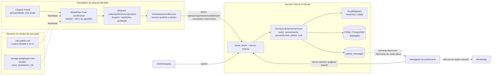

# Arquitetura e fluxo de dados

> **RASCUNHO — 2026-10-04.** Gerado com apoio de IA; requer revisão por responsável humano.
> Descreve o código local da branch `claude/plataforma`. **Hospedagem de produção não decidida**; nada está implantado além do ambiente local de desenvolvimento. Países de tratamento de fornecedores marcados "a confirmar".

## 1. Visão geral

## 2. Camadas e componentes

| Camada | Componentes | Observações |
| --- | --- | --- |
| Captura | `hooks/useCamera.ts` | `facingMode: user`, ideal 720×1280, `audio: false`; trilhas encerradas ao sair |
| Rastreamento | `lib/pose/loadPoseLandmarker.ts`, `lib/pose/modelInfo.ts`, `lib/pose/convertLandmarks.ts` | Modelo `pose_landmarker_full/float16/1`; runtime WASM 0.10.17 de CDN; pacote JS 0.10.35 (divergência); `runningMode: VIDEO`; limiares de confiança 0,5; eixo X espelhado na conversão |
| Qualidade e enquadramento | `lib/framing.ts`, `lib/positioning.ts`, checagens por módulo | Visibilidade, orientação frontal/lateral, extensão vertical |
| Métricas | `lib/geometry.ts`, `lib/angles.ts`, `modules/*/angles.ts`, `lib/smoothing.ts` (EMA α=0,35), `lib/movementDetection.ts` | **Coordenadas normalizadas sem correção de proporção** (RISCO-001) |
| Regras do módulo | `components/*Flow.tsx`, `modules/*/store.ts`, `lib/resultRules.ts` | Repetições, blocos, perguntas de segurança |
| Integração com o atendimento | `components/care/CareAssessmentRunner.tsx` | Reinicia a store, registra início/interrupção, envia resumo sem `frames`, oculta resultado provisório da pessoa |
| Contrato de resultado | `lib/care/resultAdapters.ts`, `lib/care/protocols.ts` | Recalcula médias no servidor; nulos para captura insuficiente; faixa plausível |
| Serviços | `lib/server/services/*.ts` | Autorização, ciclo de avaliação, acesso da pessoa, liberação, auditoria |
| Sessões | `lib/server/session.ts` | Cookies `httpOnly`, `sameSite=lax`, `secure` em produção; tokens guardados como hash |
| Dados | `db/schema.ts`, `db/migrations/0000_inicial.sql`, `db/client.ts` | PGlite (PostgreSQL em WebAssembly) local; mesmo schema serve a PostgreSQL hospedado |
| Mensagens | `outbox_messages`, `app/dev/caixa-de-saida` | Nada é enviado; página só existe fora de produção |
| Configuração | `config/platform.ts`, `config/precision.ts`, `config/app.ts`, `next.config.js` | Prazos de acesso, versão do algoritmo, identidade UORT (legado), cabeçalhos |

## 3. Fluxos de dados

| ID | Fluxo | Origem → destino | Dados | Proteções |
| --- | --- | --- | --- | --- |
| FD-01 | Cadastro/acesso do profissional | Navegador → servidor → banco | Nome, e-mail, senha (vira hash scrypt), registro profissional | Bloqueio por falhas; cookie `httpOnly` |
| FD-02 | Cadastro de pessoa e vínculo | Profissional → servidor → banco | Nome, contato, cidade/UF, objetivo do acompanhamento | Autorização por espaço e papel |
| FD-03 | Convite | Servidor → `outbox_messages` (e-mail/SMS) ou link `wa.me` aberto pelo profissional | Nome do espaço, link com token, validade | Token só como hash na tabela de convites; **link em texto no corpo da caixa de saída** |
| FD-04 | Confirmação | Pessoa → servidor → `outbox_messages` | Código de 6 dígitos ao contato cadastrado (canal WhatsApp usa SMS para o código) | Hash do código; 10 min; 5 tentativas; **código em texto no corpo da caixa de saída** |
| FD-05 | Aceites | Pessoa → servidor → banco | Documento, versão, decisão, nome digitado | Escopo da sessão da pessoa |
| FD-06 | Download do motor | CDN → navegador | Arquivos WASM e modelo | Versões fixas na URL; **sem verificação de integridade**; o CDN recebe IP e `User-Agent` |
| FD-07 | Captura e cálculo | Câmera → MediaPipe → módulos (no aparelho) | Imagem e pontos do corpo em memória | Não persistidos nem enviados |
| FD-08 | Início/resultado/interrupção | Navegador → `/api/acompanhamento/*` → banco | Chave idempotente; `userAgent`, `videoWidth`, `videoHeight`; tentativas (ângulo máximo, duração, compensação), contexto relatado (dor, lado, tempo de queixa); motivo de interrupção | Mesma origem; corpo ≤ 512 KB; validação de formato; recalculo; `frames` removidos no cliente e descartados no servidor |
| FD-09 | Revisão e devolutiva | Profissional → banco → pessoa | Decisões, valores corrigidos, justificativas, texto da orientação | Autorização por vínculo; append-only |
| FD-10 | Relatório | Banco → navegador do profissional → impressão/PDF local | Dados persistidos | Acesso auditado; PDF fica sob controle de quem imprime |
| FD-11 | Auditoria | Serviços → `audit_events` | Ator, ação, objeto, metadados (ids, estados, versões) | Sem conteúdo clínico por convenção (não há teste) |
| FD-12 | Modo de validação | Câmera → navegador (localStorage, sessionStorage, IndexedDB) → arquivos CSV/JSON baixados | Códigos de voluntário/examinador, medidas, referência, pontos 2D/3D brutos, `userAgent` | Fica no aparelho até exportação; ativado por parâmetro de URL |
| FD-13 | Avaliação livre `/assessment/*` | Câmera → navegador | Resultado em memória | Nada é enviado ao servidor (sem persistência) |

## 4. O que sai do celular da pessoa

| Sai do aparelho | Não sai do aparelho |
| --- | --- |
| Ângulos e tempos por tentativa, contexto relatado, qualidade, motivo de interrupção | Vídeo, imagens, quadros |
| `userAgent` e dimensões do vídeo | Pontos do corpo quadro a quadro (fora do modo de validação) |
| Requisição de download do modelo/WASM ao CDN (IP, `User-Agent`) | Áudio (não solicitado) |
| Nome digitado no aceite e código de confirmação | |

Desde 04/10/2026 o aviso de privacidade, a página inicial e o aceite `uso_camera` (versão `2026-10-minuta-2`) mencionam os dados técnicos do aparelho (navegador e resolução da câmera). O texto continua minuta pendente de revisão jurídica (PE-09).

## 5. Fornecedores e terceiros

| Terceiro | Uso | Dados recebidos | País de tratamento | Situação contratual |
| --- | --- | --- | --- | --- |
| jsDelivr (CDN) | Runtime WASM do MediaPipe | IP, `User-Agent`, URL | A confirmar (CDN global) | Nenhuma |
| Google Cloud Storage (`storage.googleapis.com`) | Modelo de pose | IP, `User-Agent`, URL | A confirmar (CDN global) | Nenhuma; licença do modelo a verificar (PE-17) |
| WhatsApp (Meta) | Envio manual do link pelo profissional | Telefone e mensagem com link do convite | A confirmar | Nenhuma; ação do profissional fora da plataforma |
| Provedor de e-mail/SMS | Não implementado | — | — | PE-22 |
| Hospedagem e banco gerenciado | **Não decidido** | Todos os dados persistidos | A definir | PE-11 |
| GitHub (`lookassessoria10-collab/moveo`) | Repositório de código | Código; nenhum dado de pacientes deve ser commitado (`.data/` está no `.gitignore`) | A confirmar | Visibilidade do repositório a verificar |
| Vercel | Publicação anterior do app legado (`moveo-omega.vercel.app`, citado no plano) | Nenhum dado persistido pelo legado | A confirmar | A verificar se a nova plataforma será publicada ali |

Nenhuma ferramenta de análise de uso, publicidade, gravação de sessão ou fonte externa é carregada (verificado por busca de URLs no código em 2026-10-04).

## 6. Ambientes

| Ambiente | Existe? | Observação |
| --- | --- | --- |
| Desenvolvimento local | Sim | PGlite em `.data/pglite`; seed fictício (`npm run db:seed`); caixa de saída visível |
| Testes automatizados | Sim | PGlite em memória por execução (`createTestDb`) |
| Homologação | Não | — |
| Produção | Não | Exige PE-11, REQ-048, REQ-050 e chaves/segredos fora do código |

Dentro de um mesmo ambiente, espaços `demonstracao` e `real` são separados por registro (`workspaces.environment`); um espaço de demonstração nunca vira real. Isso **não** substitui ambientes e bancos separados exigidos no cap. 24.4.

## 7. Decisões de arquitetura relevantes para risco

- Isolamento por servidor + chaves estrangeiras compostas; **sem RLS** no PostgreSQL.
- Registro append-only para revisões e devolutivas; a medida original nunca é sobrescrita.
- Versões gravadas em cada sessão: `app_version`, `protocol_id/version`, `algorithm_version`, `model_id`, `runtime_version`, `device`.
- Nenhum reprocessamento automático de resultados de atendimento existe; o script `scripts/reprocess-validation.ts` trabalha só com arquivos do modo de validação.
